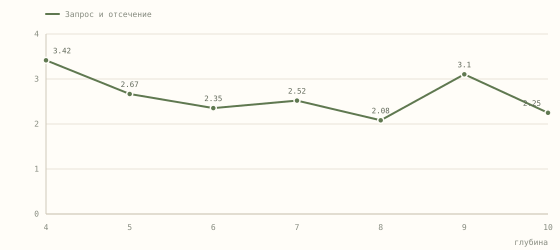
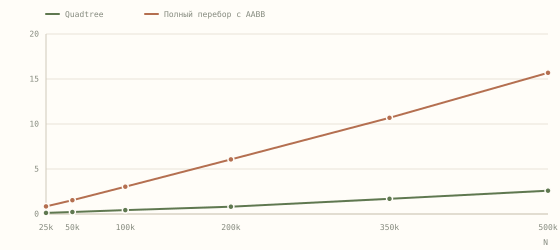

# Аналитический отчёт · Лабораторная работа 5

**Тема:** алгоритмы отсечения отрезков и многоугольников
**Реализация:** `pkg lab 5`, ванильные HTML/CSS/JavaScript, Canvas 2D
**Контрольный запуск:** Firefox 159.0.1 без видимого окна, macOS, Apple M1, 1440 × 1100, DPR 1

---

## 1. Задача и выбранный вариант

Номер по списку и номер варианта — **11**. В части 1 используется параметрическое отсечение Лианга–Барски. В части 2 выпуклый многоугольник отсекается прямоугольным окном методом Сазерленда–Ходжмана.

В дополнение реализованы сравнение с Сазерлендом–Коэном и Сайрусом–Беком, отсечение сложных контуров методом Уайлера–Атертона, битовый AABB-префильтр и индекс Quadtree на движущейся базе из 500 000 отрезков.

Приложение импортирует отрезки и прямоугольник из файла. На координатном поле исходная геометрия, окно и результат выделены разными цветами. Мышью можно перемещать и менять размер окна. Кнопка ✎ включает перенос отрезка за линию и изменение длины или угла за конец.

---

## 2. Архитектура

| Модуль | Ответственность |
|---|---|
| `geometry.js` | отсечение отрезков, коды вершин, AABB-маски, счётчики операций |
| `polygon.js` | отсечение выпуклых и сложных контуров, сшивка границ, классификация частей и дыр |
| `quadtree.js` | вставка AABB и запрос по прямоугольнику |
| `app.js` | Canvas-рендеринг, события, замеры, графики, тест-кейсы |

Геометрическое ядро не зависит от Canvas. Это позволяет считать операции и время отдельно от отрисовки.

---

## 3. Отсечение отрезков

### 3.1. Сазерленд–Коэн

Каждой вершине сопоставляется 4-битный код:

| Бит | Условие |
|---|---|
| `LEFT` | `x < xmin − ε` |
| `RIGHT` | `x > xmax + ε` |
| `BOTTOM` | `y < ymin − ε` |
| `TOP` | `y > ymax + ε` |

Если `codeA | codeB = 0`, отрезок виден полностью. Если `codeA & codeB ≠ 0`, он полностью вне одной полуплоскости и отбрасывается. Иначе выбирается внешняя вершина и вычисляется пересечение с границей.

Прямая задаётся явно относительно первого исходного конца. Вычисление пересечений в локальных координатах окна уменьшает потерю точности при больших смещениях начала координат.

```text
A = y₂ − y₁, B = x₁ − x₂
A·(x − x₁) + B·(y − y₁) = 0
x = xb  ⇒  y = y₁ − A·(xb − x₁) / B
y = yb  ⇒  x = x₁ − B·(yb − y₁) / A
```

Общий внешний бит проверяется перед поиском пересечения. Если оба конца лежат снаружи одной стороны, алгоритм завершает работу до деления.

### 3.2. Лианг–Барски

Отрезок записывается параметрически:

```text
P(t) = P₀ + t·(P₁ − P₀),  t ∈ [0, 1]
```

Для каждой стороны решается неравенство `pᵢ·t ≤ qᵢ`. В формулах используются границы окна, расширенные на ε.

```text
p = [−dx, dx, −dy, dy]
q = [x₀ − xmin, xmax − x₀, y₀ − ymin, ymax − y₀]
pᵢ < 0  ⇒  t₀ = max(t₀, qᵢ/pᵢ)
pᵢ > 0  ⇒  t₁ = min(t₁, qᵢ/pᵢ)
```

Если оба конца находятся внутри полуплоскости, она не ограничивает интервал. Если оба снаружи, отрезок сразу отбрасывается. Деление выполняется только при пересечении стороны. При `t₀ > t₁` общей части нет.

Все три метода используют один и тот же допуск `10⁻⁷` в мировых координатах. Концы результата в пределах ε привязываются к исходным границам окна. У очень длинного отрезка небольшой зазор в `t` может соответствовать заметному расстоянию, поэтому сравнение параметров не использует мировой ε напрямую.

### 3.3. Сайрус–Бек

Для каждой из четырёх границ хранится внутренняя нормаль `n` и точка `F`. Условие видимости:

```text
n·(P(t) − F) ≥ 0
f(t) = n·(P₀ − F) + t·(n·d)
```

Если `n·d > 0`, неравенство даёт нижнюю границу `t`, если `n·d < 0` — верхнюю. Метод добавлен для сравнения векторного и параметрического подходов.

### 3.4. Счётчики операций

На демонстрационном наборе из 18 отрезков (14 видимых частей, 4 отброшенных, 3 вырожденные точки):

| Алгоритм | × | ÷ | + | Сравнения | Σ арифметики |
|---|---:|---:|---:|---:|---:|
| Сазерленд–Коэн | 11 | 11 | 92 | 94 | 114 |
| Лианг–Барски | 22 | 14 | 202 | 132 | 238 |
| Сайрус–Бек | 314 | 14 | 468 | 132 | 796 |

На этом наборе методы дают одинаковые видимые части. Счётчики умножений и делений учитывают геометрическое ядро. Подготовка общих границ с допуском, привязка результата к границам, AABB и отрисовка вынесены из сравнения.

---

## 4. Отсечение многоугольников

### 4.1. Сазерленд–Ходжман

Выпуклый контур последовательно отсекается четырьмя полуплоскостями. При переходе через границу в выходной список добавляется точка пересечения. Если текущая вершина внутри, она также сохраняется. Для сложной геометрии приложение переключается на Уайлера–Атертона.

### 4.2. Уайлер–Атертон

1. В обе границы, исходную и отсекающую, вставляются общие узлы пересечений в порядке вдоль каждого ребра. В исходных контурах также разбиваются самопересечения и наложения.
2. Для каждой дуги между узлами определяется заполненность слева и справа. В исходной фигуре используется правило чётности, в прямоугольнике — принадлежность окну. Совпадающие дуги имеют общую битовую маску, которая учитывает вклад обеих границ.
3. Дуга входит в результат, если пересечение заполнено только с одной её стороны. Дуга ориентируется так, чтобы заполнение осталось слева.
4. Обход идёт вдоль дуг границы. В общем узле он переходит на другую границу, когда продолжение исходной выходит из пересечения. При касании направление выбирается по ближайшей дуге по часовой стрелке от обратного направления. Каждый замкнутый обход образует выходной контур.

### 4.3. Топология и площадь

Внешний контур имеет положительную ориентированную площадь, дыра — отрицательную. Их сумма даёт площадь пересечения. Если дыра открывается на край окна, её граница становится частью внешнего контура. Если она проходит через всё окно, остаются две отдельные части. Окно целиком внутри дыры даёт пустой результат.

У пентаграммы с правилом чётности остаются пять лучей. У «банта» с нулевой алгебраической площадью два заполненных треугольника суммарной площади 18.

---

## 5. Пространственный индекс и AABB

### 5.1. Битовый префильтр

Для габарита `box` и окна `w`:

```text
if (box.xmax < w.xmin − ε) code |= LEFT
else if (box.xmin > w.xmax + ε) code |= RIGHT
if (box.ymax < w.ymin − ε) code |= BOTTOM
else if (box.ymin > w.ymax + ε) code |= TOP
```

Ненулевой код означает, что габарит целиком лежит за одной из сторон. По той же маске можно сразу отбросить узел дерева с его потомками.

### 5.2. Движущаяся база

Отрезки разбиты на четыре группы блоками по 1024 элемента. Каждая группа движется со своим фазовым сдвигом по двум синусоидам. В мировых координатах концы всех 500 000 отрезков меняют положение. Окно движется по отдельной траектории.

У каждой группы своё дерево Quadtree с AABB в локальных координатах. Для группы со смещением `(dx, dy)` окно запроса сдвигается на `(−dx, −dy)`. После отсечения видимые концы сдвигаются обратно. Это даёт те же результаты, что и перемещение всех отрезков перед запросом. Исходная геометрия рисуется из четырёх кэшированных слоёв, которые сдвигаются синхронно с группами.

### 5.3. Параметры индекса

- Область дерева в локальных координатах — `[0, 1000]²`.
- Порог разбиения листа — 64 отрезка. Максимальная глубина — от 3 до 10, по умолчанию 8.
- AABB может пересекать несколько дочерних узлов. При запросе дубликаты удаляются по метке `_stamp`.
- Стоимость запроса зависит от числа посещённых узлов и проверенных габаритов. При большой области запроса или сильной кластеризации дерево может приблизиться к полному перебору.

---

## 6. Контрольные замеры

### 6.1. Условия

- Генератор с фиксированным начальным состоянием создаёт короткие отрезки. До привязки к краям их длина составляет 4–20 единиц. В среднем 42 % отрезков распределены вокруг 18 кластеров, остальные — равномерно.
- Замер глубины использует 48 положений окна и групп на 500 000 отрезков. Замер плотности использует 32 положения для каждого размера базы.
- Обе серии используют Лианга–Барски. При полном переборе сохраняется битовый AABB-префильтр. Для каждого положения сравнивается число видимых частей.
- Таймер учитывает запрос, отбраковку и отсечение. Генерация, построение дерева, отрисовка и обновление интерфейса измеряются отдельно или исключены из времени запроса.

### 6.2. Построение индекса и живой режим

| Параметр | Значение |
|---|---:|
| Отрезков | 500 000 |
| Максимальная глубина | 8 |
| Узлов во всех четырёх деревьях | 63 056 |
| Построение четырёх деревьев | 570 мс |
| Кандидатов в начальном положении | 3 650 |
| Видимых частей в начальном положении | 3 621 |
| Запрос и отсечение в начальном положении | 2,00 мс |

Через 1,2 с после запуска анимации собраны интервалы кадров за 16 с. В среднем получилось **59,8 FPS**, индикатор округлил частоту до **60 FPS**. Для 95 % интервалов время кадра составило не больше 16,7 мс, самый длинный интервал — 33,3 мс. Движение базы и отсекающего окна было включено весь замер.

### 6.3. Время от глубины дерева

| Глубина | Запрос и отсечение, мс |
|---:|---:|
| 4 | 3,42 |
| 5 | 2,67 |
| 6 | 2,35 |
| 7 | 2,52 |
| 8 | **2,08** |
| 9 | 3,10 |
| 10 | 2,25 |



На этом запуске минимальное среднее время получилось при глубине 8. Неглубокое дерево проверяет больше габаритов в крупных листьях. При увеличении глубины добавляется обход узлов, а длинные габариты попадают в несколько листьев. Разница между близкими значениями глубины зависит от расположения окна и нагрузки браузера.

### 6.4. Время от плотности данных

| Отрезков | Quadtree, мс | Полный перебор с AABB, мс | Ускорение |
|---:|---:|---:|---:|
| 25 000 | 0,13 | 0,84 | ×6,5 |
| 50 000 | 0,22 | 1,53 | ×7,0 |
| 100 000 | 0,44 | 3,03 | ×6,9 |
| 200 000 | 0,81 | 6,06 | ×7,5 |
| 350 000 | 1,69 | 10,69 | ×6,3 |
| 500 000 | 2,59 | 15,69 | ×6,1 |



При фиксированных размерах области и окна число отрезков определяет плотность. Полный перебор проверяет каждый габарит, а Quadtree пропускает целые квадранты за пределами окна. На 500 000 отрезков среднее время уменьшилось примерно в **6,1 раза**. Число видимых частей совпало во всех 32 положениях для каждого из шести размеров базы.

---

## 7. Тест-кейсы

Встроенный набор — **24 из 24** проверок пройдено в контрольном запуске.

| № | Проверка | Ожидание |
|---:|---|---|
| 1 | отрезок полностью внутри | видим целиком |
| 2 | отрезок полностью вне | отброшен |
| 3 | пересечение левой границы | начало ровно на `xmin` |
| 4 | отрезок на нижней границе | коллинеарен, видим |
| 5 | нулевая длина в вершине | вырожденная точка |
| 6 | нулевая длина вне окна | отброшен |
| 7 | вертикальный через окно | корректно при `dx = 0` |
| 8 | выход из вершины | остаётся точка |
| 9 | граница в пределах ε | `xmax + 10⁻⁹` считается границей |
| 10 | диагональ через всё окно | все методы совпадают |
| 11 | вогнутый L-профиль | 1 контур, `S = 39` |
| 12 | отверстие внутри окна | 2 контура, дыра, `S = 64` |
| 13 | ребро по границе окна | площадь не удваивается, `S = 60` |
| 14 | ребро через вершину окна | ромб, `S = 100` |
| 15 | две изолированные части | 2 компоненты, `S = 15` |
| 16 | самопересекающаяся звезда | 5 граней, `S = 13,36` (тестовый контур); пресет — `1217,91` |
| 17 | дыра прижата к границе | открытый вырез, 1 часть, 0 дыр, `S = 64` |
| 18 | самопересекающийся «бант» | 2 грани, `S = 18` |
| 19 | промах рядом с углом | все три метода отбрасывают отрезок |
| 20 | почти параллельный границе отрезок | видна только часть в пределах допуска |
| 21 | окно внутри дыры | пустой результат |
| 22 | дыра пересекает окно насквозь | 2 части, 0 дыр, `S = 80` |
| 23 | окно отсекает перемычку U-контура | 2 части, `S = 36` |
| 24 | частичное наложение двух контуров | двойное покрытие исключается, `S = 18` |

Все тесты выполняются в браузере при загрузке страницы и по кнопке «Перезапустить».

---

## 8. Воспроизведение

```bash
open index.html
```

1. Открыть раздел «500 000».
2. Нажать «Подготовить 500k» (или дождаться автоподготовки).
3. Включить «Живой режим» — в панели появятся FPS, query + clip, число кандидатов.
4. Нажать «Замер глубины» — построится первый график.
5. Нажать «Замер плотности» — построится второй график.

Оба графика перестраиваются из результатов запуска. На частоту кадров и замеры влияют браузер, размеры Canvas и фоновая нагрузка.

---

## 9. Ограничения

- Движение задаётся на уровне четырёх групп. Индекс хранится в локальных координатах группы. При независимом изменении формы или положения отдельного отрезка внутри группы его габарит пришлось бы переиндексировать.
- Обработка многоугольников проверяет пары входных рёбер и покрытие каждой полученной дуги. Стоимость растёт с числом рёбер и пересечений.
- Частота кадров измеряется по интервалам `requestAnimationFrame`. На экране с другой частотой обновления и при другой нагрузке результат изменится.

## 10. Вывод

Вариант 11 работает в двух базовых режимах и обрабатывает сложные контуры. На одинаковых положениях окна и движущейся базы число видимых частей совпало с полным перебором. Графики показывают, как глубина дерева и плотность набора влияют на время запроса и отсечения.
